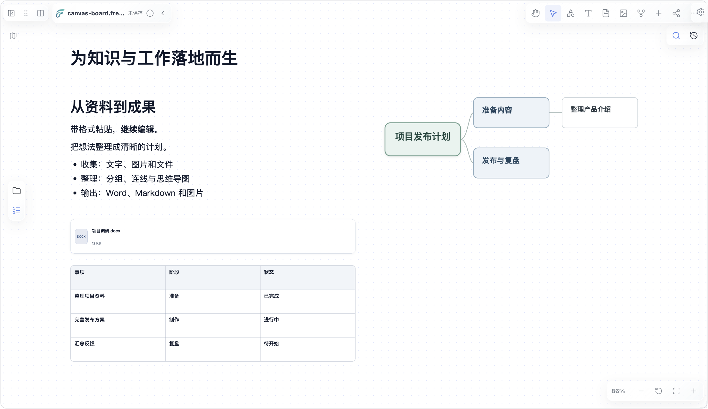

<p align="center">
  
</p>

<h1 align="center">FreeFlow</h1>

<p align="center"><strong>为知识与工作落地而生。</strong></p>

<p align="center">
  将文字、图片、文件、表格、代码与公式放在同一张画布中，<br />
  收集资料，整理思路，继续编辑，输出成果。
</p>

<p align="center">
  <a href="https://github.com/WuXinbo-bo/FreeFlow-WorkBorad/releases"><strong>下载应用</strong></a> ·
  <a href="docs/getting-started.md">开始使用</a> ·
  <a href="docs/github-sync.md">多设备同步</a> ·
  <a href="docs/assistant-plugin.md">可选插件</a> ·
  <a href="https://github.com/WuXinbo-bo/FreeFlow-WorkBorad/issues">反馈问题</a>
</p>

<p align="center">
  
  
  <a href="LICENSE.md"></a>
</p>

## 一个可以继续工作的画布

FreeFlow 是本地优先的桌面画布工作台。把资料放在一起，用可编辑的内容表达关系，再将整理结果导出为文档。日常画布操作无需登录，也无需配置 AI。

它适合个人研究、学习笔记、方案梳理和非商业项目整理。使用范围以 [许可证](LICENSE.md) 为准。



<p align="center"><sub>当前 mac 分支的示例画布：带格式文本、文件卡片、表格与思维导图。</sub></p>

## 从材料到成果

| 你想做的事 | FreeFlow 提供的能力 |
| --- | --- |
| 收集资料 | 粘贴带格式文本、Markdown 和图片，拖入本地文件，在画布中自由摆放 |
| 继续编辑 | 编辑富文本、表格、代码与公式；使用图形、连线、分组和思维导图组织内容 |
| 阅读与加工文件 | 预览 PDF、DOCX、文本和表格，查找与摘取内容，将页面或区域生成图片 |
| 管理工作内容 | 工作区与画布目录、跨画布搜索、最近画布、回收站和本地历史恢复 |
| 输出成果 | 按所选内容导出 Word、Markdown、图片、PDF 等；Word 支持预览和调整阅读顺序 |
| 跨设备接续 | 授权自己的 GitHub 私有仓库，同步工作区内多个画布及符合规则的附件 |

画布以 `.freeflow` 文件保存。预览、编辑和转换的支持范围不同，不能把所有文件都当作完整 Office 文档编辑；具体能力见 [使用指南](docs/getting-started.md#文件预览与转换)。

## 下载与平台

从 [GitHub Releases](https://github.com/WuXinbo-bo/FreeFlow-WorkBorad/releases) 查看已发布附件。当前公开应用版本为 **v2.0.2，提供 Windows 安装包与免安装包；Mac 应用暂未公开上传**。源码版本与已公开安装包可能不同，以发布页的附件及验证说明为准。

| 平台 | 版本与状态 |
| --- | --- |
| Windows 10/11 x64 | 支持安装版与免安装版；发布包通常为 `.exe` |
| macOS · Apple Silicon | M 系列本地测试版已打包实测，暂无公开下载；可从 `mac` 分支自行构建 `.app`，ZIP／DMG 分发仍以发布页为准 |
| macOS · Intel | 构建配置已保留，尚未完成 Intel 真机验收，不作为已验证版本推荐 |

当前 Mac 测试包使用本地 ad-hoc 签名，尚未完成 Developer ID 签名及 Apple 公证。仅从本仓库取得测试包，遇到系统阻止时按 [Apple 官方说明](https://support.apple.com/102445) 核对并处理；不要关闭系统安全保护。

应用内“应用更新”提供新版下载入口，运行新版安装包完成升级。已有数据与自定义工作区保存在安装目录之外；升级前仍建议备份重要画布和附件。

## 数据由你管理

FreeFlow 先将内容保存到本机。默认目录如下，也可以在设置中选择工作区：

| 内容 | Windows | macOS |
| --- | --- | --- |
| 画布 | `%USERPROFILE%\FreeFlow\CanvasBoards` | `~/Library/Application Support/FreeFlow/CanvasBoards` |
| 设置与应用数据 | `%USERPROFILE%\FreeFlow\AppData` | `~/Library/Application Support/FreeFlow/AppData` |

关联的外部文件可能仍位于原路径。备份或迁移时，请同时保留所需附件；本地历史与回收站不能代替完整资源备份。

**GitHub 同步是可选项。** 每位用户授权自己的私有仓库，FreeFlow 不把用户画布集中存放在开发者仓库。另一台设备连接同一仓库后，可将远程画布拉取到当前工作区，再继续编辑与同步。

默认同步图片上限为 5 MiB，普通文件为 10 MiB，视频不上传；超限或不可用附件保留占位信息。本机保存成功与远端同步成功分别显示。同步服务面向个人多设备接续，采用检查、拉取与冲突处理流程，不提供多人实时共同编辑。完整步骤及限制见 [GitHub 同步指南](docs/github-sync.md)。

## AI 镜像与可选助手

- **AI 镜像**属于主程序，可独立使用；具体镜像来源与交互方式受操作系统及来源应用限制。
- **AI 助手**是可选的官方插件。不安装时，画布与镜像照常使用，不加载助手界面和后台。
- 在“系统设置 → 画布插件”中查看安装、更新与导入入口。安装通过签名校验和自检后，下次启动启用；可停用、重新开启或卸载。
- 助手需要用户自行配置支持的模型服务或 CLI；FreeFlow 不附送模型账号、API 额度或本地大模型。

官方插件通过本仓库的 [`plugins` 分支](https://github.com/WuXinbo-bo/FreeFlow-WorkBorad/tree/plugins) 维护版本目录，签名安装包存放在 GitHub Releases。可安装版本以设置页实际检查结果为准；网络不可用时可导入官方 `.ffplugin` 包。插件下载不使用用户的画布同步 Token。

开发、兼容范围、签名与安装恢复见 [插件说明](docs/assistant-plugin.md)。目前面向官方插件，不承诺运行任意第三方代码。

## 从源码运行

需要 **Node.js 24 LTS 或更高版本**与 npm；构建依赖请使用完整 `npm ci` 安装。选择对应平台分支：

```sh
# macOS
git clone --branch mac https://github.com/WuXinbo-bo/FreeFlow-WorkBorad.git
```

```sh
# Windows
git clone --branch win https://github.com/WuXinbo-bo/FreeFlow-WorkBorad.git
```

```sh
# 克隆后，在项目根目录执行
cd FreeFlow-WorkBorad
npm ci
npm run prepare:desktop-build
npm run start:desktop
```

依赖与构建就绪后，也可使用仓库根目录的启动脚本：Mac 为 `Start-FreeFlow.command`，Windows 为 `start-desktop.cmd`。启动脚本运行当前本地源码，不负责更新源码或安装依赖。

`npm start` 启动网页开发服务，默认监听 `http://127.0.0.1:53127`，以终端实际地址为准。网页模式不包含全部桌面文件、窗口和同步能力；日常使用请选择桌面应用。

## 开发与贡献

| 分支 | 职责 |
| --- | --- |
| [`main`](https://github.com/WuXinbo-bo/FreeFlow-WorkBorad/tree/main) | 通用开发基线，保留 Windows 桌面能力 |
| [`mac`](https://github.com/WuXinbo-bo/FreeFlow-WorkBorad/tree/mac) | macOS 适配、原生验证与打包 |
| [`win`](https://github.com/WuXinbo-bo/FreeFlow-WorkBorad/tree/win) | Windows 验证与发布版本 |
| [`plugins`](https://github.com/WuXinbo-bo/FreeFlow-WorkBorad/tree/plugins) | 官方插件目录、兼容信息与分发规范 |

```sh
npx playwright install chromium
npm run prepare:desktop-build
npm test
npm run check:release-version
npm run check:desktop-packaging
```

通用修改应同步到应用分支，平台适配保留各自边界。Windows 原生能力需要在 Windows 验证；Mac 原生能力需要在 Mac 验证。打包命令、分支维护、发布命名及插件发布隔离见 [分支与发布指南](docs/branch-and-release.md)。

欢迎提交可以复现的 [Issue](https://github.com/WuXinbo-bo/FreeFlow-WorkBorad/issues) 或范围清晰的 Pull Request。请附版本、系统、操作步骤和必要截图，移除账号、访问令牌、个人文件路径及业务内容。

## 许可

FreeFlow 使用自定义非商业许可证，允许符合条款的非商业使用、修改与分发。**企业内部使用、付费服务和其他商业用途需要事先取得书面授权。** 本仓库可公开阅读源码，不代表采用 MIT 等允许自由商用的许可证。

完整条款与商业授权联系方式以 [LICENSE.md](LICENSE.md) 为准。
